<!-- Items marked [EDIT] (in README and in assets/*.svg) are placeholders: replace with your real details. -->

 

 

 

<!-- Small supplement: tool icons -->

  

 

<!-- [EDIT] Add repo links, e.g.
<a href="https://github.com/ayushchaurasiya1412-design/SmartEduSystem">SmartEduSystem</a> ·
<a href="https://github.com/ayushchaurasiya1412-design/Nivaran">Nivaran</a>
-->

<h3>⚡ GitHub Stats</h3>

  <picture>
    <source media="(prefers-color-scheme: dark)" srcset="https://github-readme-stats.vercel.app/api?username=ayushchaurasiya1412-design&show_icons=true&hide_border=true&bg_color=0b0f1a&title_color=ff2e93&icon_color=b6ff3b&text_color=e6e9f2&ring_color=ffb703" />
    <source media="(prefers-color-scheme: light)" srcset="https://github-readme-stats.vercel.app/api?username=ayushchaurasiya1412-design&show_icons=true&hide_border=true&bg_color=ffffff&title_color=e01e82&icon_color=5a9e00&text_color=2d3748&ring_color=e68a00" />
    
  </picture>
  <picture>
    <source media="(prefers-color-scheme: dark)" srcset="https://github-readme-stats.vercel.app/api/top-langs/?username=ayushchaurasiya1412-design&layout=compact&hide_border=true&bg_color=0b0f1a&title_color=ff2e93&text_color=e6e9f2" />
    <source media="(prefers-color-scheme: light)" srcset="https://github-readme-stats.vercel.app/api/top-langs/?username=ayushchaurasiya1412-design&layout=compact&hide_border=true&bg_color=ffffff&title_color=e01e82&text_color=2d3748" />
    
  </picture>

  <picture>
    <source media="(prefers-color-scheme: dark)" srcset="https://streak-stats.demolab.com?user=ayushchaurasiya1412-design&hide_border=true&background=0b0f1a&ring=ff2e93&fire=ffb703&currStreakNum=b6ff3b&currStreakLabel=ffb703&sideNums=e6e9f2&sideLabels=8b93a7&dates=8b93a7&stroke=2a3147" />
    <source media="(prefers-color-scheme: light)" srcset="https://streak-stats.demolab.com?user=ayushchaurasiya1412-design&hide_border=true&background=ffffff&ring=e01e82&fire=e68a00&currStreakNum=2d3748&currStreakLabel=e01e82&sideNums=2d3748&sideLabels=4a5568&dates=718096&stroke=e2e8f0" />
    
  </picture>

<h3>🐍 Contribution Snake</h3>

<picture>
  <source media="(prefers-color-scheme: dark)" srcset="https://raw.githubusercontent.com/ayushchaurasiya1412-design/ayushchaurasiya1412-design/output/github-snake-dark.svg" />
  <source media="(prefers-color-scheme: light)" srcset="https://raw.githubusercontent.com/ayushchaurasiya1412-design/ayushchaurasiya1412-design/output/github-snake.svg" />
  
</picture>

<h3>📈 Activity Graph</h3>

<picture>
  <source media="(prefers-color-scheme: dark)" srcset="https://github-readme-activity-graph.vercel.app/graph?username=ayushchaurasiya1412-design&bg_color=0b0f1a&color=ff2e93&line=ff2e93&point=b6ff3b&area=true&area_color=ff2e93&title_color=ffb703&hide_border=true" />
  <source media="(prefers-color-scheme: light)" srcset="https://github-readme-activity-graph.vercel.app/graph?username=ayushchaurasiya1412-design&bg_color=ffffff&color=e01e82&line=e01e82&point=2d3748&area=true&area_color=e01e82&title_color=e68a00&hide_border=true" />
  
</picture>

  

 

  

 

